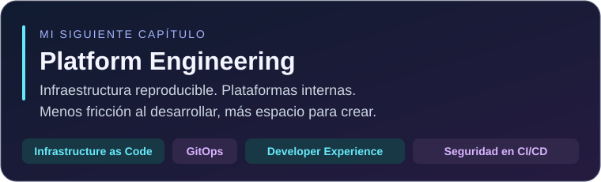



## Del aprendizaje a soluciones reales 🚀

### 🎓 Ingeniería de Software · UNMSM
### 💼 Practicante de Ingeniería de Software · Mibanco

**Conecto backend, automatización y cloud para convertir ideas en soluciones.**
 
Cada proyecto es una oportunidad para aprender, mejorar y compartir lo aprendido.

 

  

## ☁️ Mi enfoque

<table>
<tr>
<td align="center" width="33%"><h3>☁️ Cloud &amp; DevSecOps</h3>Automatización y seguridad en el ciclo de desarrollo.</td>
<td align="center" width="33%"><h3>⚙️ Calidad &amp; QA</h3>Procesos trazables. Pruebas con revisión humana.</td>
<td align="center" width="33%"><h3>✨ IA aplicada</h3>Agentes que apoyan el trabajo de los equipos.</td>
</tr>
</table>

 

## 🛠️ DevSecOps & Cloud

  

 

## 💻 Código & herramientas

 

  

### 🧭 Herramientas por explorar

  

---

## ✦ Aprender. Construir. Compartir.
### Código con propósito. Curiosidad en cada paso.

🇵🇪 **Desde Perú, con ganas de seguir creando.**

