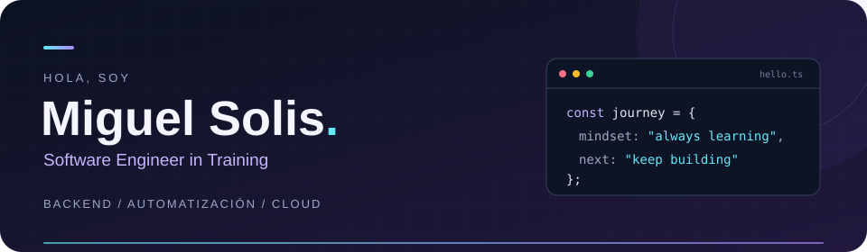



 

Estudiante en **UNMSM** · Practicante de Ingeniería de Software en **Mibanco** 🇵🇪
 
Me gusta construir, automatizar y aprender algo nuevo en el camino.

 

 

&nbsp;

  

### ☁️ DevSecOps & Cloud

  

### ⚙️ Código & herramientas

 

### 🧭 Próximos horizontes · Platform Engineering

Me interesa explorar infraestructura como código, plataformas internas y una mejor experiencia para desarrolladores.

  

  

Infrastructure as Code &nbsp; / &nbsp; GitOps &nbsp; / &nbsp; Developer Experience &nbsp; / &nbsp; Seguridad en CI/CD

  

☁️ Cloud &amp; DevSecOps &nbsp; · &nbsp; ⚙️ Automatización QA &nbsp; · &nbsp; ✨ IA aplicada

  

**Aprender. Construir. Compartir.**

